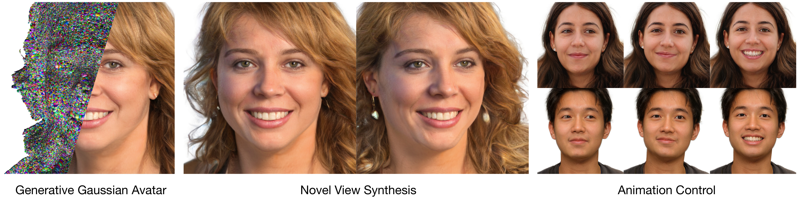

# <center>NVIDIA GAIA</center>



GAIA is an acronym for <u>G</u>enerative <u>A</u>nimatable <u>I</u>nteractive <u>A</u>vatars. This is the official code repo for the SIGGRAPH 2025 paper:

**GAIA: Generative Animatable Interactive Avatars with Expression-conditioned Gaussians**<br>
[*Zhengming Yu*](https://yzmblog.github.io/),
[*Tianye Li*](https://tianyeli.github.io/),
[*Jingxiang Sun*](https://mrtornado24.github.io/),
[*Omer Shapira*](https://omershapira.com/about-me/),
[*Seonwook Park*](https://swook.net/),
[*Michael Stengel*](https://scholar.google.de/citations?user=9_GCtwUAAAAJ&hl=de), 
[*Matthew Chan*](https://matthew-a-chan.github.io/website/about/about.html), 
[*Xin Li*](https://people.tamu.edu/~xinli/), 
[*Wenping Wang*](https://scholar.google.com/citations?user=28shvv0AAAAJ), 
[*Koki Nagano*](https://luminohope.org/), 
[*Shalini De Mello*](https://research.nvidia.com/person/shalini-de-mello)<br>
**[Project Page](https://research.nvidia.com/labs/amri/projects/gaia/)**
| **[Paper](https://dl.acm.org/doi/10.1145/3721238.3730737)**


>3D generative models of faces trained on in-the-wild image collections have improved greatly in recent times, offering better visual fidelity and view consistency. Making such generative models animatable is a hard yet rewarding task, with applications in virtual AI agents, character animation, and telepresence. However, it is not trivial to learn a well-behaved animation model with the generative setting, as the learned latent space aims to best capture the data distribution, often omitting details such as dynamic appearance and entangling animation with other factors that affect controllability. We present GAIA: Generative Animatable Interactive Avatars, which is able to generate high-fidelity 3D head avatars for both realistic animation and rendering. To achieve consistency during animation, we learn to generate Gaussians embedded in an underlying morphable model for human heads via a shared UV parameterization. For modeling realistic animation, we further design the generator to learn expression-conditioned details for both geometric deformation and dynamic appearance. Finally, facing an inevitable entanglement problem between facial identity and expression, we propose a novel two-branch architecture that encourages the generator to disentangle identity and expression. On existing benchmarks, GAIA achieves state-of-the-art performance in visual quality as well as realistic animation. The generated Gaussian-based avatar supports highly efficient animation and rendering, making it readily available for interactive animation and appearance editing.

## Installation

We recommend to use [Anaconda](https://www.anaconda.com/). The build is developed and tested on:

- **GPU**: NVIDIA A100-SXM4-80GB (1, 2 and 8 GPUs), driver 535.129.03
- **OS**: Ubuntu 22.04, x86-64
- **Python / PyTorch**: Python 3.8, PyTorch 2.1.0 + CUDA 12.1, torchvision 0.16.0, pytorch3d 0.7.7

Other Ampere/Hopper GPUs should work, but are untested. The CUDA toolchain comes from conda, so
no system CUDA installation or container is needed.

### Quick start

    git clone https://github.com/NVlabs/GAIA.git && cd GAIA
    ./install.sh submodules
    ./install.sh env
    conda activate gaia
    ./install.sh extensions
    ./install.sh verify

`install.sh` and the asset download are run from the repo root. Everything after that, training and 
inference scripts run from `gaia/`, which is the Python import root:

    cd gaia

<details>
<summary><b>Notes on submodules</b> -- what they are, and why not to use <code>--recursive</code></summary>

GAIA uses four third-party components as git submodules under `gaia/third_party/`. None are
optional: two are on the import path via symlinks, two are the CUDA extensions.

| Submodule | Pin | Why it is needed |
|---|---|---|
| `gaussian-splatting` | `472689c` | `gaia/{scene,utils,gaussian_renderer,arguments}` are symlinks into it |
| `smirk` | `c7de404` | `gaia/flame/FLAME.py` subclasses it; `gaia/flame/{lbs,_smirk_flame,_smirk_util}.py` are symlinks into it |
| `diff-gaussian-rasterization` | `59f5f77` | CUDA extension, built by `./install.sh extensions` |
| `simple-knn` | `86710c2` | CUDA extension, built by `./install.sh extensions` |

`./install.sh submodules` fetches exactly these, and `./install.sh verify` imports through every
symlink, so a bad checkout fails there rather than mid-training. If the submodules are missing the
symlinks dangle and you get `ModuleNotFoundError: No module named 'scene'`.

**Do not run `git submodule update --init --recursive` at the top level.** `gaussian-splatting`
carries its own `.gitmodules` pinning a *different, older* `simple-knn` and pulling in
`SIBR_viewers`; neither is used by GAIA, and the older `simple-knn` fails to compile on recent
nvcc. `install.sh` recurses only into `diff-gaussian-rasterization`, which genuinely needs its
nested `third_party/glm`.

</details>


## Datasets and Assets

### Datasets

For acquiring and preprocessing the datasets, see [`dataset_preprocessing/README.md`](dataset_preprocessing/README.md). Image alignment and cropping are done by the pipeline of [EG3D](https://github.com/NVlabs/eg3d/tree/main/dataset_preprocessing), used unmodified and run upstream; on top of those crops GAIA runs [MODNet](https://github.com/ZHKKKe/MODNet) for alpha mattes and [SMIRK](https://github.com/georgeretsi/smirk) for FLAME shape and expression coefficients, then packs the 380-dim labels.


### Assets

Use `gaia/flame/assets/setup_assets.sh` to produce everything under `gaia/flame/assets/`.
It is kept separate from `install.sh` on purpose.

**First, get FLAME 2020 yourself.** It is not redistributed with GAIA and no script here
downloads it: accept the licence at [FLAME](https://flame.is.tue.mpg.de/), download
`FLAME2020.zip`, and unzip it into `gaia/flame/assets/` so that
`FLAME2020/generic_model.pkl` exists. `setup_assets.sh` will not run until it does.

Then run the script, with the environment activated:

    conda activate gaia
    cd gaia/flame/assets
    bash setup_assets.sh
    cd -

<details>
<summary><b>Notes on assets</b> -- prerequisites, what the script produces, how to verify</summary>

Both installation steps must be done first, not just the environment:

- submodules initialized: the UV masks are generated from SMIRK's `FLAME_masks.pkl`, which
  lives in `gaia/third_party/smirk/`.
- environment created and activated: the last two steps of the script are `python`, not `curl`.
- FLAME 2020 already unzipped into `gaia/flame/assets/FLAME2020/`, as above.

The script downloads one file, `head_template.obj` from FlashAvatar at a pinned commit. It
symlinks the four SMIRK assets from the pinned submodule, **generates**
`flame_uv_close_mouth.obj` and the ten `flame_uv_masks/*.png`, and ends by running
`verify_assets.py`. That check fails if a downloaded file or a UV mask does not match its pinned
SHA256. `flame_uv_close_mouth.obj` is the exception: it comes out of floating-point math, so a
different hash only prints a WARN, and the structural checks decide whether the mesh is correct.

Verify an install without re-downloading anything:

    python gaia/flame/assets/verify_assets.py --numeric

If you also intend to run the dataset preprocessing, FLAME 2020 is needed in a **second** location
as well (a symlink). See
[`dataset_preprocessing/README.md`](dataset_preprocessing/README.md).

</details>


## Multi-stage Training on FFHQ dataset

    cd gaia

    # stage 0: train shape-only branch at 256 resolution
    sh scripts/train_stage_0.sh

    # stage 1: train shape-only branch at 512 resolution
    sh scripts/train_stage_1.sh

    # stage 2: train two branches at 512 resolution
    sh scripts/train_stage_2.sh


Practical Concerns: The training procedures were tested on eight A100 GPUs with large RAM for caching the datasets. For training (debugging) with less resources, add `--num <DATA_NUM>` to adjust the dataset size, and use appropriate `--gpus=<GPU_NUM> --batch=<BATCH_SIZE>` that fits your system.


## Inference

### Pre-trained Model for GAIA

Download the model file from [here](https://github.com/NVlabs/GAIA/releases/download/v1.0/GAIA-FFHQ-release.pkl) and put it at `pretrained_models/GAIA-FFHQ-release.pkl`.

The released checkpoint carries **no FLAME model data**, which is licensed by Max Planck and we do
not redistribute it. The FLAME tensors are constants, so they are rebuilt from your own
`gaia/flame/assets/` download when the checkpoint is loaded. Complete the [Assets](#assets) step
first, or loading will stop with a message telling you to.

Your own training snapshots are unaffected: they embed FLAME as before and load unchanged. If you
need to override the behaviour, all inference scripts take
`--flame-source {auto,checkpoint,assets}` (default `auto`).

### Generate animation

The animation is driven by per-frame FLAME parameters (`--flame-params`) tracked from a video of a
face. No driving sequence is shipped; make one from your own video's frames with
`dataset_preprocessing/make_flame_params.py`, in the dataset-preprocessing environment (see
[`dataset_preprocessing/README.md`](dataset_preprocessing/README.md), section 5):

    python dataset_preprocessing/make_flame_params.py \
        --frames path/to/frames --out gaia/eval/flame_params/driving.json --count 500

Then:

    cd gaia
    python gen_animation.py \
        --outdir=eval/animation/driving/ --trunc=0.7 --seeds=15 --grid=1x1 \
        --network=./pretrained_models/GAIA-FFHQ-release.pkl \
        --flame-params=./eval/flame_params/driving.json

If per-frame eye gaze is available for the driving video, pass it with `--eye_gaze gaze.txt` (one
row per frame, two gaze angles in radians) to drive the eye motion as well.

### Generate novel view video

This script needs the processed FFHQ `dataset.json` (the training labels, see
[dataset_preprocessing/README.md](dataset_preprocessing/README.md)). Each seed takes its FLAME
shape and expression from one entry in it. The file is not shipped, so build the dataset first,
then extract the file from the zip with `unzip -p FFHQ_512.zip dataset.json > dataset.json`.

    cd gaia
    python gen_novel_view.py \
        --outdir=eval/novel_view --trunc=0.7 --seeds=272 --grid=1x1 --w-frames=120 \
        --network=./pretrained_models/GAIA-FFHQ-release.pkl \
        --dataset_json=path/to/dataset.json \
        --save_images False


<a name="citation"></a>
## Citation
If you find this work useful for your research, please consider citing our paper: 

```bibtex
@inproceedings{yu2025gaia,
  title={GAIA: Generative Animatable Interactive Avatars with Expression-conditioned Gaussians},
  author={Yu, Zhengming and Li, Tianye and Sun, Jingxiang and Shapira, Omer and Park, Seonwook and Stengel, Michael and Chan, Matthew and Li, Xin and Wang, Wenping and Nagano, Koki and De Mello, Shalini},
  booktitle={Proceedings of the Special Interest Group on Computer Graphics and Interactive Techniques Conference Conference Papers},
  pages={1--10},
  year={2025}
}
```


<a name="license"></a>
## License

This project is released under the **NVIDIA Source Code License for GAIA**. See
[`LICENSE`](LICENSE) for the full text.

### Third-party components

GAIA incorporates and depends on third-party software, each governed by its own license. See
[`THIRD-PARTY.txt`](THIRD-PARTY.txt) for the complete list of components, versions, licenses and
how each is used.

Two points worth highlighting:

- The Gaussian Splatting components (`gaussian-splatting`, `diff-gaussian-rasterization`,
  `simple-knn`) are licensed by Inria/MPII for **non-commercial research and evaluation only**.
  They are consumed as git submodules and are **not redistributed** with this repository —
  `./install.sh submodules` (see [Installation](#installation)) fetches them from upstream under
  upstream's terms.
- **FLAME 2020 assets are not redistributed.** You must download them yourself from
  [flame.is.tue.mpg.de](https://flame.is.tue.mpg.de) after accepting the FLAME license; see
  `gaia/flame/assets/setup_assets.sh`.

Anyone intending use beyond non-commercial research should review the license of every component
listed in [`THIRD-PARTY.txt`](THIRD-PARTY.txt).
